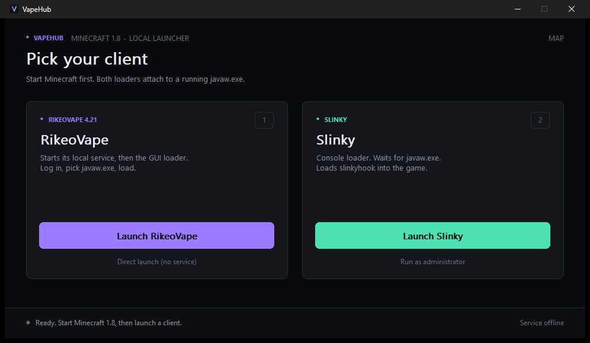

# VapeHub

A small Windows hub for launching Minecraft 1.8 clients. Pick a client, the hub starts whatever it needs and gets out of the way.



## What it does

- **RikeoVape** — starts the local Java service on free loopback ports (defaults 8080/8091, auto-fallback when they are taken), waits until both ports answer, exports `VAPE_ONLINE_BASE_URL` and `VAPE_ZEUS_ADDRESS`, then opens `vape_v4_rewrite.exe` with the correct working directory.
- **Direct launch** — opens `Vape421Injector.exe` in a console with its own Java window picker. No service.
- **Slinky** — opens `slinkyloader.exe` in a new console with its own working directory, plus a run-as-admin variant.
- Reuses an already running service (pid + ports tracked in `%LOCALAPPDATA%\VapeHub\service.txt`), and only ever stops the instance it started.
- Elevation: tries a normal `CreateProcess` first, falls back to `ShellExecuteEx runas` only when Windows demands it.
- DPI-aware custom UI: `1` / `2` / `3` / `Esc`.

## Download & setup

This repository is the hub source. The client folders are distributed separately as an archive that already matches the layout the hub expects.

1. Download the bundle: [`VapeHub-1.8-bundle.zip`](https://www.mediafire.com/file/z2jzr0gw2t8g29i/VapeHub-1.8-bundle.zip/file) (~67 MB).
2. Extract it into any folder, for example `C:\VapeHub`. You should end up with:

```
VapeHub\
├── VapeHub.exe
├── openvape\
│   ├── vape_v4_rewrite.exe                    GUI loader
│   ├── Vape421Native.dll                      loader component
│   ├── Vape421Injector.exe                    console launcher
│   ├── vape421-experimental-service-0.1.0.jar local service
│   └── service.bat                            manual service starter
├── slinky\
│   ├── slinkyloader.exe
│   ├── slinkyhook.dll
│   └── slinky_library.dll
└── data\                                      created at runtime
```

3. Requirements: Windows 10/11 x64, and a JDK 17+ (`java.exe` on `PATH`) for the local service. Slinky needs the MSVC 2015–2022 runtime, which ships with stock Windows.

Building from source instead? Produce `VapeHub.exe` with the build below and drop it next to the two extracted folders — only the exe is replaced, the archive's `openvape\` and `slinky\` stay as they are.

Alternate locations:

- `VAPEHUB_OPENVAPE_DIR` — folder with the RikeoVape files
- `VAPEHUB_SLINKY_DIR` — folder with the Slinky files
- fallback search: exe folder → `openvape\` ; `slinky\` → `payloads\slinky\`

## Build

Requires a mingw-w64 or llvm-mingw toolchain (`clang++`, `llvm-windres`) on `PATH`, or set `CXX` / `WINDRES`.

```
cd src
build.bat
```

Output is `..\VapeHub.exe`. Manual equivalent:

```
llvm-windres VapeHub.rc -O coff -o build\VapeHub.res.o
clang++ -std=c++17 -O2 -mwindows -static -DUNICODE -D_UNICODE -DWIN32_LEAN_AND_MEAN -DNOMINMAX -D_WIN32_WINNT=0x0A00 main.cpp build\VapeHub.res.o -o ..\VapeHub.exe -lws2_32 -lshell32 -lshlwapi -lole32 -lgdi32 -luser32 -ladvapi32
```

Icon is generated by `src/gen_icon.py` (pure Python, no dependencies).

## Usage

1. Start Minecraft 1.8.9 on a 64-bit Java runtime and wait for the main menu.
2. Run `VapeHub.exe`. The status log lists every client file it found, so a missing piece is visible immediately.
3. Pick a client:

   - **`1` — RikeoVape**: the hub starts the local service on free loopback ports, waits for it to answer, exports `VAPE_ONLINE_BASE_URL` / `VAPE_ZEUS_ADDRESS`, and opens the loader. Approve the single UAC prompt if Windows shows one. In the loader, sign in with any username (the bundled service accepts any name for local use), pick the game window, and load.
   - **`2` — Slinky**: opens in its own console and waits for the game process. Keep the console open until it attaches; closing it afterwards is fine. If it cannot attach, use the run-as-administrator variant.
   - **`3` — Direct**: opens the console launcher with its own window picker. No service and no sign-in — the online features stay offline in this mode.

4. Controls: `1` RikeoVape · `2` Slinky · `3` direct · `Esc` quit. The service label in the status bar stops the service the hub started.

CLI:

```
VapeHub.exe --selftest
VapeHub.exe --launch openvape [--no-loader]
VapeHub.exe --launch direct
VapeHub.exe --launch slinky
VapeHub.exe --launch slinky-admin
VapeHub.exe --stop-service
```

`vapehub.log` sits next to the exe.

## Service handling

The service is spawned detached (no console, output to `data\service.log`), so closing the hub does not kill it. The hub reuses it on the next run when the recorded pid is alive, the image is `java.exe`, and both ports answer. Clicking the service label in the status bar (or `--stop-service`) terminates only that pid.

Tested with JDK 21 against the 17-target service jar; any 17+ runtime works.

## Limits

- Built for 1.8-class clients; one active client per game session.
- A second load into the same JVM hangs — restart Minecraft between attempts.
- On a filtered-admin account the RikeoVape loader triggers one UAC prompt (its manifest is `highestAvailable`).
- The local service is experimental: username-only login, single JSON store inside `data\`.

## License

MIT — see [LICENSE](LICENSE).
